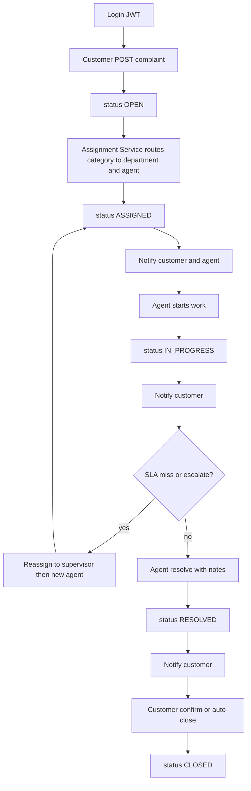

# ResolveNow — target flow and database

**Status:** design locked to the course brief. Not implemented yet.

Stay aligned with the brief: **Complaint / Assignment / Notification** services plus Auth, Gateway, Eureka. Do **not** rename `complaint` to `request`. Extend the sample tables with extra columns; do not add a fourth business microservice.

An earlier canvas suggested renaming to `request` and adding `escalation` / `department` / `request_comment` tables. That is **superseded**. This file is the source of truth.

## What is already in place vs the brief

Already done: JWT register/login, Gateway + Eureka, Feign chain on create (`Complaint → Assignment → Notification`), four Postgres DBs.

Not done: real **lifecycle**, **department + agent assignment**, **notify on every update**, **escalation**, **tests**, **load balancing**, **deploy**.

Current create path hardcodes `assignedTo = 1L` and only notifies once. `PUT /api/complaints/{id}/status` accepts any string from any JWT.

## Target flow

**Roles in JWT** (`users.role`): `CUSTOMER` (register), `AGENT`, `SUPERVISOR`, `ADMIN` (seeded, not self-register).

| Step | Actor | Call | Status |
|---|---|---|---|
| Login | Any | `POST /api/auth/login` | — |
| Log issue | CUSTOMER | `POST /api/complaints` | `OPEN` |
| Assign department + agent | Assignment Service (Feign from create) | internal `POST /api/assignments` | `ASSIGNED` |
| Alert | Notification Service | internal `POST /api/notifications` | — |
| Start | Assigned AGENT | `POST /api/complaints/{id}/start` | `IN_PROGRESS` |
| Escalate | Customer, agent, or SLA job | `POST /api/complaints/{id}/escalate` → Assignment reassigns | `ESCALATED` then `ASSIGNED` |
| Resolve | Assigned AGENT | `POST /api/complaints/{id}/resolve` | `RESOLVED` |
| Close | CUSTOMER or auto | `POST /api/complaints/{id}/close` | `CLOSED` |

**Inter-service rule (matches the brief):**

- **Create and escalate:** Complaint Service → Assignment Service → Notification Service (and Assignment calls back `PUT .../status`).
- **Start / resolve / close:** Complaint Service updates lifecycle, then **Complaint → Notification** so users get alerts on every update.

**Status machine:**

`OPEN → ASSIGNED → IN_PROGRESS → RESOLVED → CLOSED`, plus `ASSIGNED | IN_PROGRESS → ESCALATED → ASSIGNED` after supervisor/agent reassignment. Remove unconstrained public `PUT /status` (keep it internal for Assignment only).

**Escalation (no extra service):** same `complaint_id`. Assignment Service writes a **new** assignment row (`assigned_to` = supervisor or next agent, `escalation_level + 1`), previous row marked inactive. Triggers: customer/agent reason, or a `@Scheduled` SLA check (High 4h, Medium 24h, Low 72h with no `IN_PROGRESS`).

**Assignment routing:** category → department → least-loaded **enabled AGENT** whose `users.department_id` matches. Auth Service needs `GET /api/auth/agents?department=` so Assignment does not hardcode user id `1`.

## Database (database-per-service)

Keep sample **table names and required columns**. Extra columns are allowed; extra unused tables are not.

### `authdb`

`users`: `user_id`, `username`, `email`, `password_hash`, `role` (`CUSTOMER|AGENT|SUPERVISOR|ADMIN`), `department_id` (null for customers), `enabled`.

**Drop `refresh_tokens`.** Written today, never used. Brief does not ask for refresh tokens.

Seed 1 admin, 1 supervisor + 2 agents per department (`BILLING`, `TECHNICAL`, `HR`, `LOGISTICS`, `GENERAL`).

### `complaintdb` — Complaint Table

Required: `complaint_id`, `user_id`, `description`, `status`.

Add: `title`, `category`, `priority` (`HIGH|MEDIUM|LOW`), `created_at`, `updated_at`, `sla_due_at`, `escalation_level` (default 0), `resolution_notes`, `resolved_by`, `resolved_at`, `closed_at`.

No separate `escalation` table. Escalation is `escalation_level` + new assignment row.

### `assignmentdb` — Assignment Table

Required: `assignment_id`, `complaint_id`, `assigned_to`.

Add: `department`, `escalation_level`, `active` (only one active row per complaint), `assigned_at`. **Drop `assignment.status`** — it duplicates complaint status.

Department list stays a seeded map in Assignment Service (brief has no Department table).

### `notificationdb` — Notification Table

Required: `notification_id`, `user_id`, `message`.

Add: `complaint_id`, `is_read`, `created_at`. Notify **both** customer and assignee on assign / start / escalate / resolve / close.

## Gateway and security

`JwtAuthFilter` already injects `X-User-Id` / `X-User-Role`. Controllers must use the role:

- Create / close / customer-escalate: `CUSTOMER` and own `user_id`
- Start / resolve / agent-escalate: `AGENT` and `assigned_to` matches
- Supervisor reassign: `SUPERVISOR`
- Internal Feign (`POST /assignments`, `POST /notifications`, `PUT .../status`): not customer APIs

Public routes stay `/api/auth/**`, `/api/complaints/**`, `/api/assignments/**`, `/api/notifications/**`.

New complaint endpoints: `GET /api/complaints/mine`, `GET /api/complaints/queue` (agent), `POST .../start`, `.../escalate`, `.../resolve`, `.../close`. Keep `GET /api/assignments/{complaintId}` for transparent department assignment.

## Remaining brief tasks (after the flow works)

- **Load balancing:** second `complaintService` instance, same `spring.application.name`, different port; Gateway `lb://complaintService`.
- **Tests:** `@WebMvcTest` + `@DataJpaTest` per service; WireMock for Feign on the create chain.
- **Deploy:** `Dockerfile` per module + root `docker-compose.yml`.

## Out of scope

Renaming Complaint Service, adding Kafka, adding a separate Escalation microservice, or keeping `refresh_tokens` without a refresh API.

## Build order

1. Auth: roles, seed agents, drop refresh tokens, agent-list endpoint
2. Complaint entity + status machine + start/resolve/close/escalate APIs
3. Assignment: real agent pick, assignment history, no duplicate status
4. Notification on every lifecycle event (customer + agent)
5. SLA scheduled escalate
6. Tests, second instance, Docker compose
